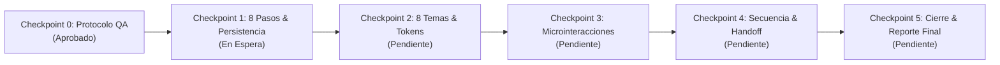

# LUMI · PROTOCOLO Y REGISTRO DE AUDITORÍA INDEPENDIENTE: ONBOARDING V7

**Proyecto:** Lumi Android (Jetpack Compose)  
**Documento de Control:** `ONBOARDING_AUDIT.md`  
**Auditor Responsable:** `lumi-visual-auditor` (Subagente Independiente de Visual QA)  
**Rama:** `feature/lumi-onboarding-v7`  
**Worktree:** `.worktrees/onboarding-v7`  
**Fuentes de Verdad y Especificación:**
1. `reference/lumi_onboarding_v7_luz_cromatica.html` (Especificación oficial visual, cinética y de diseño v7)
2. `context/Lumi_Contexto_Continuidad_Onboarding_v7.md` (Reglas de producto, decisiones éticas y restricciones)
3. `.agents/agents/lumi-visual-auditor.md` (Contrato y límites del rol de auditoría)
4. `ONBOARDING_IMPLEMENTATION_PLAN.md` (Plan maestro de etapas y arquitectura)

---

## 1. Declaración de Principios y Reglas de Auditoría

1. **Estricta independencia y solo lectura de producción:**
   - El auditor visual jamás modifica archivos en `app/src/main/` ni en `HomeScreen.kt`. No implementa componentes de producción ni altera la base de código que audita.
   - Cualquier sugerencia técnica se expresa exclusivamente en este documento o en parches de texto para evaluación del implementador.
2. **Cero resultados fabricados:**
   - No se marcará como verificado ningún punto sin una evidencia concreta (captura de pantalla, traza de ejecución de pruebas automatizadas, log de estado o inspección visual en dispositivo/emulador).
   - Se declarará con total transparencia qué aspectos fueron probados y cuáles quedaron pendientes de prueba física o de entorno.
3. **Fidelidad perceptiva y de movimiento:**
   - La fidelidad visual se evaluará frente al HTML v7 de referencia respetando densidades, proporciones de pantalla y fluidez a 60/120 FPS.

---

## 2. Taxonomía de Severidad de Hallazgos

| Nivel | Definición | Impacto y Criterio de Aceptación |
| :--- | :--- | :--- |
| **P0 (Bloqueante)** | Crashes fatales, fugas de memoria críticas, corrupción o pérdida de datos, dobles guardados en Room/DataStore, creación de ciclos fantasma sin fecha de inicio, congelamiento de UI o imposibilidad de completar el flujo. | **Bloquea el merge.** El implementador debe corregirlo de inmediato antes de avanzar. |
| **P1 (Mayor)** | Desviación visual o cinética mayor frente al HTML v7, destellos blancos en temas oscuros, halo grisáceo en secuencias atmosféricas, texto médico engañoso o indicadores ficticios de IA, violación severa de contraste OLED o inoperancia de `prefers-reduced-motion`. | **Bloquea el cierre de la etapa correspondiente.** Requiere corrección en el siguiente ciclo. |
| **P2 (Menor)** | Desalineaciones menores de padding/espaciado (< 4dp), desfase sutil en tiempos de animación (< 15%), curvas de easing ligeramente más abruptas, inconsistencias menores de clipping que no rompen la UI. | Corrección programada dentro del sprint o refinamiento de pulido. |
| **P3 (Mejora / Pulido)** | Sugerencias de optimización de recomposición en Compose, simplificación de shaders/canvas, mejoras de legibilidad o pequeños refinamientos no bloqueantes. | Opcional, a criterio del implementador si no afecta plazos. |

---

## 3. Matriz de Verificación: Flujo de Pasos (8 Pasos)

### 3.1 Modo Seguimiento (`Tracking`) vs Modo Acompañante (`Observer`)

| Paso | Identificador | Título / Pantalla | Modo Seguimiento | Modo Acompañante | Reglas de Validación y Elementos Clave |
| :---: | :--- | :--- | :---: | :---: | :--- |
| **0** | `Step0Welcome` | **Bienvenida** | ✅ Activo | ✅ Activo | • Hero `LumiBrandLockup` grande con flor viva y estrella oscilante. • Selector de modo: «Seguir mi ciclo» (`track`) y «Acompañar a alguien» (`support`). • Tarjetas interactivas con indicador circular reactivo y halo de selección. • Botón CTA: "Empezar →" (Habilitado siempre). |
| **1** | `Step1Safety` | **Seguridad** | ✅ Activo | ✅ Activo | • Panel disclaimer médico: «Lumi acompaña, no diagnostica». • Mensajes éticos claros: no es anticonceptivo, estimaciones no certezas, acudir a profesional. • Checkbox de consentimiento con trazo SVG progresivo animado. • Enlace a política de privacidad (abre modal accesible sin contenido falso). • Botón CTA: "Continuar →" (**Deshabilitado** hasta marcar consentimiento). |
| **2** | `Step2Nickname` | **Tu nombre o apodo** | ✅ Activo | ✅ Activo | • Input con animación viva: subrayado expansivo (0% a 100%), 4 destellos flotantes (`nameDotLift`), rotación +13° del icono de destello en foco. • Tarjeta reactiva de saludo: "Hola, *apodo*." actualizándose en tiempo real. • Campo opcional (máx 32 caracteres). Botón siempre habilitado ("Continuar →"). • Texto al pie: "Puedes omitir este paso". |
| **3** | `Step3CycleRegularity` | **Tu ciclo** | ✅ Activo | ❌ Omitido | • 3 opciones de regularidad: "Sí, es regular", "No, es irregular", "No estoy segura". • Selector de duración aproximada (stepper circular 21 a 45 días, default 28). • Chip toggle para indicar si conoce o no la duración estimada. • Botón CTA: **Deshabilitado** hasta seleccionar una de las 3 opciones de regularidad. |
| **4** | `Step4LastPeriod` | **Último periodo** | ✅ Activo | ❌ Omitido | • Chips excluyentes: "Elegir fecha" / "No recuerdo". • Si elige fecha: selector de fecha nativo accesible (Material 3 DatePicker). • Validación: Si "Elegir fecha" está activo, el CTA se **deshabilita** hasta elegir una fecha válida. • Si "No recuerdo": CTA habilitado inmediatamente; **no crea ciclo en Room**. |
| **5** | `Step5Preferences` | **Preferencias** | ✅ Activo | ❌ Omitido | • Grid 2x2 de objetivos: "Entender mi ciclo", "Conocer mi bienestar", "Buscar embarazo", "Evitar embarazo". Selección individual accesible. • Selector de anticoncepción hormonal con pastilla deslizante (**glider**) de 3 estados ("Sí", "No", "Prefiero no decir"). Curva de glider `370ms cubic-bezier(.2,.9,.25,1)`. |
| **6** | `Step6Customization` | **Últimos detalles** | ✅ Activo | ❌ Omitido | • Duración del sangrado: Stepper numérico (1 a 10 días) + quick chips (`3 d`, `4 d`, `5 d`, `6 d`). • Grid 3x2 de síntomas/intereses: Cólicos, Sueño, Ánimo, Fertilidad, Estrés (selección múltiple). • Acordeón opcional de perfil físico: Edad, Estatura, Peso. • Botón CTA: "Terminar →" (Habilitado siempre). |
| **7** | `Step7Summary` | **Todo listo / Resumen** | ✅ Activo | ✅ Activo | • Hero `LumiBrandLockup` centrado, idéntico al origen del vuelo final. • En seguimiento: 4 tarjetas de resumen editables (Saludo, Ciclo, Último periodo, Objetivo) con botón directo "Editar" que navega al paso respectivo. • En acompañante: Tarjeta especial "Conectar con alguien". • Botón CTA: "Ver mi inicio" que dispara la persistencia y la secuencia final. |

---

## 4. Matriz de Verificación: 8 Temas Cohesivos y Soporte OLED

| Tema | Familia | Fondo (`--bg`) | Panel (`--panel`) | Acento (`--accent`) | Rosa (`--rose`) | Contraste OLED y Cero Destello |
| :--- | :---: | :---: | :---: | :---: | :---: | :--- |
| **Noir** | Oscuro | `#0e0c13` | `#1d1924` | `#cbb4f1` | `#e6afca` | Fondo negro profundo uniforme. Sin halos grises en transiciones. |
| **Ciruela** | Oscuro | `#141017` | `#241d29` | `#dbb5ec` | `#e8adc8` | Tonos vino oscuros, cielo nocturno fucsia-violeta suave. |
| **Bosque** | Oscuro | `#0c1413` | `#17231f` | `#a3d4bd` | `#b7d4bd` | Base esmeralda oscura, resplandor verde agua tenue sin blanqueado. |
| **Índigo** | Oscuro | `#0d1122` | `#1a2037` | `#c0c9ff` | `#c7afdf` | Base azul marino medianoche, estrellas lavanda-azuladas. |
| **Pétalo** | Claro | `#fcf7f7` | `#fffafb` | `#9369b2` | `#ce849f` | Fondo rosa empolvado. **Cielo de estrellas totalmente apagado** (`opacity: 0`). |
| **Marfil** | Claro | `#faf6ee` | `#fffcf7` | `#90718f` | `#c99193` | Tono crema cálido. Sin artefactos de estrellas ni velos oscuros. |
| **Salvia** | Claro | `#f2f7f2` | `#fcfefd` | `#5c8e76` | `#82aa94` | Verde vegetal claro, alta legibilidad de textos. Estrellas desactivadas. |
| **Lavanda** | Claro | `#f8f5fe` | `#fffcff` | `#8f70bd` | `#bd8fc3` | Lavanda suave y limpio, acento violeta editorial. Estrellas desactivadas. |

### Criterios Críticos de Color y Tema:
1. **Revelación circular sin destellos blancos (`LumiThemeCircularReveal`):** La transición de tema se ejecuta con `clipPath: circle(r at cx, cy)` en 690 ms (`cubic-bezier(.2,.83,.2,1)`). La pantalla previa debe permanecer debajo intacta hasta el final de la animación para erradicar cualquier frame en blanco.
2. **Selector de temas en Bottom Sheet:** Visualización de las 8 paletas en 2 columnas con tarjetas de previsualización (muestra de fondo y círculo de acento), accesible desde el chip superior de la cabecera en cualquier paso.

---

## 5. Matriz de Microinteracciones, Canvas y Animaciones

| Microinteracción | Especificación HTML v7 | Criterio de Verificación en Jetpack Compose | Estado |
| :--- | :--- | :--- | :---: |
| **Botón Primario CTA** | Pill 999px con doble animación interna: halo cónico giratorio (`lumiButtonOrbit` 3.7s linear) y cinta de luz elíptica desplazada (`lumiButtonDrift` 4.7s alternate). El texto nunca gira. Al pulsar: escala `0.973`. | Implementación en Compose con `drawWithContent` / `Canvas`, sweep gradient giratorio + radial gradient elíptico amortiguado. Reacción instantánea al tacto. | Pendiente Etapa 3 |
| **Checkbox de Consentimiento** | SVG de 30x30 con trazado progresivo: contorno en 550ms (`cubic-bezier(.2,.72,.3,1)`) y tick en 380ms (`cubic-bezier(.15,.85,.25,1)`) desfasado 155ms. Relleno suave con opacidad 0.12. | Canvas nativo con `PathMeasure` y `animateFloatAsState` reproduciendo la secuencia temporal del trazo. | Pendiente Etapa 3 |
| **Input de Apodo** | Subrayado expansivo (ancho de 0% a 100% en 550ms `cubic-bezier(.25,.8,.25,1)`), 4 destellos luminosos (`nameDotLift` 2.3s vertical) y rotación sutil (+13°, escala 1.08) del icono de destello en foco. | Composable `BasicTextField` con ornamentos decorativos y línea base animada en respuesta al estado de foco (`isFocused`). | Pendiente Etapa 3 |
| **Glider Anticoncepción** | Pastilla deslizante segmentada (3 opciones) con traslación `Modifier.offset` y ajuste de ancho responsivo en 370ms (`cubic-bezier(.2,.9,.25,1)`). | Box contenedor con cálculo dinámico de posición de pestaña seleccionada y resplandor glow suave. | Pendiente Etapa 3 |
| **Fondo de Estrellas** | 3 capas de estrellas continuas e infinitas (baja: 44s, media: 73s, alta: 116s), ascendiendo de `translate3d(0,0,0)` a `translate3d(0,-50%,0)` con seed pseudoaleatoria (4409). Parpadeo suave en subconjunto de estrellas. | Canvas de renderizado optimizado con posiciones deterministas, atenuación en pasos 1..6 y brillo en pasos 0 y 7. Apagado en temas claros. | Pendiente Etapa 3 |
| **Transición de Pasos** | Paso saliente se desplaza lateralmente (-20px) con desenfoque suave (4px) en 290ms; nuevo paso entra (+20px) con fade-in y desenfoque inverso en 460ms. | Animación Compose coordinada mediante `AnimatedContent` o interpoladores custom que eviten solapamientos rígidos. | Pendiente Etapa 1 |

---

## 6. Secuencia Atmosférica Final y Handoff con Home

### 6.1 Secuencia Ceremonial (~11.5 s / ~10.2 s)
- **Activación:** Se dispara únicamente tras pulsar "Ver mi inicio" en el Paso 7 y tras completarse la persistencia.
- **Fondo Cromático Prismático:** Velo oscuro profundo sobre el que se despliegan 4 orbes de luz difuminada:
  * Orbe Rosa: órbita suave en 6.4s (`lumiPinkOrbit`).
  * Orbe Violeta: órbita suave en 7.3s (`lumiVioletOrbit`).
  * Orbe Verde Agua / Salvia: órbita suave en 6.9s (`lumiSageOrbit`).
  * Orbe Melocotón: órbita suave en 7.8s (`lumiPeachOrbit`).
  * **Regla Crítica:** Sin tinte blanco, sin modo de fusión que aclare el negro a gris. En temas claros la opacidad se amortigua al 46%.
- **Logo Lumi Central Vivo:** Logo ampliado (`scale(1.17)`), flor oscilando entre -7° y +8° en 2.9s (`lumiFlowerV7`), estrella titilando entre 0.91 y 1.36 en 2.6s (`lumiStarV7`).
- **Secuencia de Textos Escalados:** 5 mensajes poéticos y verídicos, sin alegar procesamiento de IA ni demoras ficticias:
  1. *01.30s:* "Tu espacio empieza aquí" / "Un momento para hacerlo tuyo"
  2. *03.45s:* "Conociendo tus preferencias" / "Solo lo que decidiste compartir"
  3. *05.55s:* "Un lugar a tu manera" / "Sin prisas, sin expectativas"
  4. *07.78s:* "Preparando tu bienvenida" / "Tus elecciones estarán a mano"
  5. *09.77s:* "Todo está listo" / "Bienvenida a Lumi"
- **Omisión Rápida:** Botón "Entrar ahora ↗" que aparece suavemente a los 850ms y permite cancelar la espera y entrar al Home de inmediato.

### 6.2 Handoff Cinético hacia `LumiTopBar` (~590 ms)
- **Vuelo del Logo:** A los ~10.9s (o al pulsar "Entrar ahora"), el logo central vuela hacia la coordenada exacta del `LumiBrandLockup` en la cabecera del Home.
- **Duración del Vuelo:** ~590 ms (modo atmosférico) / ~540 ms (modo sereno) con curva `cubic-bezier(.17,.79,.21,1)`.
- **Cero Duplicación:** El logo de la transición se oculta en el milisegundo exacto en que el logo del TopBar se hace visible, garantizando continuidad visual perfecta.
- **Aparición de Home:** La pantalla de Home emerge con fade-in y ligero ascenso (`homeRevealV7` 850ms), sin destellos ni saltos bruscos.
- **Contrato de Integración:** Se mantiene desacoplado mediante callback `onComplete: () -> Unit` sin editar `HomeScreen.kt`.

---

## 7. Protocolo de Persistencia, Concurrencia y Datos

| Aspecto | Requisito Funcional | Criterio de Auditoría |
| :--- | :--- | :--- |
| **Persistencia Previa** | El guardado en DataStore y Room debe ejecutarse de forma asíncrona suspendida **antes** de lanzar la transición visual. | Si el almacenamiento falla, la animación NO debe comenzar. Se debe mostrar un mensaje visible de error y permitir "Reintentar". |
| **Prevención de Doble Guardado** | El botón de acción final se bloquea con flag atómico (`busy = true`). | No se permiten múltiples escrituras concurrentes si el usuario presiona repetidamente. |
| **Primer Ciclo en Room** | Se inserta registro en la tabla de ciclos **únicamente** si el usuario seleccionó una fecha real en el Paso 4. | Si el usuario eligió "No recuerdo" o está en modo Acompañante, **no debe crearse ningún ciclo fantasma** en la base de datos. |
| **Idempotencia de Estado** | Datos de apodo, objetivos, preferencias de anticoncepción, duración del sangrado y perfil físico se persisten limpiamente. | Los campos no seleccionados o dejados en blanco deben mantenerse `null` o vacíos, sin valores residuales ficticios. |

---

## 8. Protocolo de Accesibilidad y Reducción de Movimiento

- **Preferencia del Sistema (`prefers-reduced-motion`):**
  * Al activarse la opción de accesibilidad en el sistema Android (o el toggle de prueba), se deben deshabilitar automáticamente:
    1. Órbita cónica y drift del botón primario.
    2. Ascenso continuo de las 3 capas de estrellas.
    3. Partículas flotantes del input de apodo.
    4. Órbitas de los 4 orbes de luz cromática.
    5. Transición ceremonial de 11.5s: entra directamente al Home o realiza un desvanecimiento cruzado de 200ms sin vuelos de logo.
- **Contraste de Textos y Controles:**
  * Cumplimiento con WCAG 2.1 AA (mínimo ratio 4.5:1 para textos normales y 3:1 para textos grandes e interactivos) en los 8 temas.
- **Soporte de TalkBack y Semántica:**
  * Todas las tarjetas de modo, regularidad, objetivos e intereses deben exponer estados accesibles (`aria-pressed` / `selected`, `role = "radio"`, `contentDescription` descriptivo).

---

## 9. Registro de Checkpoints y Estado de Auditoría

### Resumen de Estados por Checkpoint

| Checkpoint | Alcance | Estado | Hallazgos Abiertos | Evidencias |
| :---: | :--- | :---: | :---: | :--- |
| **0** | **Inicialización y Protocolo Independiente** | ✅ **APROBADO** | Ninguno | `ONBOARDING_AUDIT.md`, `visual-qa/` inicializado |
| **1** | **Estructura 8 Pasos, Navegación y Persistencia** | ⏳ **EN ESPERA** | Pendiente evaluación | Se registrarán en `visual-qa/evidence/checkpoint-1/` |
| **2** | **Tokens de 8 Temas, Tipografía y Recursos de Iconos** | ⏳ Pendiente | Pendiente evaluación | Se registrarán en `visual-qa/evidence/checkpoint-2/` |
| **3** | **Microinteracciones, Estrellas y Revelación Circular** | ⏳ Pendiente | Pendiente evaluación | Se registrarán en `visual-qa/evidence/checkpoint-3/` |
| **4** | **Secuencia Atmosférica y Handoff Reusable** | ⏳ Pendiente | Pendiente evaluación | Se registrarán en `visual-qa/evidence/checkpoint-4/` |
| **5** | **Auditoría Visual Final, Edge Cases y Cierre** | ⏳ Pendiente | Pendiente evaluación | Se registrarán en `visual-qa/evidence/checkpoint-5/` |

---

## 10. Bitácora de Hallazgos y Seguimiento

*(Esta sección se irá nutriendo en cada checkpoint con la estructura: ID, Checkpoint, Severidad, Archivo/Estado, Evidencia, Impacto, Pasos de Reproducción, Criterio de Corrección y Resolución).*

*No hay hallazgos abiertos en la Etapa 0.*
