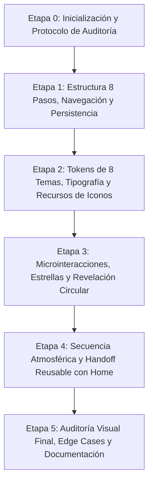

# LUMI · PLAN DE IMPLEMENTACIÓN ONBOARDING V7 NATIVO (JETPACK COMPOSE)

**Estado:** Etapa 0 — Inicialización y Coordinación de Dos Agentes  
**Rama:** `feature/lumi-onboarding-v7`  
**Worktree:** `.worktrees/onboarding-v7`  
**Referencia visual aprobada:** `reference/lumi_onboarding_v7_luz_cromatica.html` (HTML v7)  
**Roles:**
- **Implementador (Agente Principal):** Desarrollo nativo en Kotlin/Compose, arquitectura, pruebas y resolución de hallazgos.
- **Auditor Visual (Subagente `lumi_visual_auditor`):** Auditoría independiente, verificación de fidelidad visual/movimiento, paridad funcional, documentación en `ONBOARDING_AUDIT.md` y `visual-qa/`. Prohibido editar código de producción.

---

## 1. Arquitectura y Mapeo de Componentes

### 1.1 Estructura Modular de Archivos (en `com.jeremy.lumi.ui.screens.onboarding`)
Para mantener el código mantenible, desacoplado y de alta fidelidad, se estructura el onboarding en componentes especializados:

1. `OnboardingScreen.kt`: Coordinador principal de pantalla, scaffold, cabecera (`LumiTopBar` / chip de tema), barra de progreso lineal (1..8) y footer con botón primario animado y enlace secundario.
2. `OnboardingViewModel.kt`: Manejo de estado (`OnboardingUiState`), validaciones de paso, modo seguimiento vs acompañante, persistencia atómica en DataStore y creación del primer ciclo en Room solo con fecha real. Manejo de reintento ante errores de guardado.
3. `OnboardingStepComponents.kt`:
   - `Step0Welcome`: Hero brand grande, tarjetas de modo ("Seguir mi ciclo", "Acompañar a alguien").
   - `Step1Safety`: Disclaimer médico "Lumi acompaña, no diagnostica", checkbox de consentimiento con trazo SVG animado, diálogo de política.
   - `Step2Nickname`: Input de apodo animado (subrayado expansivo, destellos flotantes, rotación sutil del icono de destello), preview reactivo "Hola, *apodo*.".
   - `Step3CycleRegularity`: Selector de regularidad (regular / irregular / no estoy segura), stepper de duración (21 a 45 días, default 28).
   - `Step4LastPeriod`: Selector chip ("Elegir fecha" / "No recuerdo"), selector de fecha nativo accesible.
   - `Step5Preferences`: Grid 2x2 de objetivos (Entender ciclo, Bienestar, Buscar embarazo, Evitar embarazo) + selector segmentado deslizable de anticoncepción hormonal (Sí / No / Prefiero no decir) con glider animado.
   - `Step6Customization`: Duración del sangrado (stepper 1 a 10 días + quick chips 3d, 4d, 5d, 6d), tiles de intereses (cólicos, sueño, ánimo, fertilidad, estrés) y acordeón de perfil físico opcional (edad, estatura, peso).
   - `Step7Summary`: Resumen de 4 tarjetas editables con navegación directa al paso correspondiente (o tarjeta conectar en modo acompañante) y botón de inicio hacia la transición atmosférica.
4. `LumiAtmosphericTransition.kt`: Secuencia ceremonial final (~11.5 s / ~10.2 s):
   - Velo oscuro y campo cromático prismático (rosa, lavanda, verde agua, melocotón) sin halos grises ni blancos.
   - Logo central `LumiBrandLockup` respirando orgánicamente (rotación, escala, destello de estrella).
   - Secuencia de mensajes de bienvenida con animación vertical suave (`translateY` + `alpha`).
   - Botón "Entrar ahora ↗" para omisión inmediata.
   - Animación de vuelo del logo hacia la posición final de la cabecera (~590 ms).
   - Soporte total de `prefers-reduced-motion` y accesibilidad.
5. `LumiSkyBackground.kt`: Fondo de cielo estrellado con 3 capas ascendentes en paralaje (`skyRise` suave), puntos con parpadeo orgánico, reducción automática de brillo en pasos de formulario, apagado en temas claros y respeto a `reduced-motion`.
6. `LumiThemeCircularReveal.kt`: Transición de tema con expansión circular (690 ms `cubic-bezier(.2,.83,.2,1)`) originada desde el botón o chip de selección, garantizando cero destellos blancos en temas oscuros.
7. `LumiIconProvider.kt`: Capa de abstracción para iconografía intercambiable, preservando la compatibilidad con los candidatos temporales de `candidates-icons-NOT-FINAL/` sin acoplarlos de forma definitiva.

---

## 2. Matriz de Paridad HTML v7 ↔ Jetpack Compose

| Elemento / Característica | Especificación HTML v7 | Implementación Nativa Compose | Estado |
| :--- | :--- | :--- | :--- |
| **8 Temas Cohesivos** | Noir, Ciruela, Bosque, Índigo (oscuros) / Pétalo, Marfil, Salvia, Lavanda (claros) | Extensión de `LumiDesignTokens` con tokens exactos (`bg`, `panel`, `line`, `accent`, `rose`, `glow`, `veil1`, `veil2`, `skyA`, `skyB`) | Pendiente Etapa 2 |
| **Fondo de Estrellas** | 3 capas ascendentes continuas (44s, 73s, 116s), `translate3d(0, -50%, 0)`, sin imágenes externas | `Canvas` con 3 capas de partículas generadas pseudoaleatoriamente con seed fija (4409) y animación infinita vertical | Pendiente Etapa 3 |
| **Botón Primario CTA** | Pill 999px con halo cónico giratorio (`lumiButtonOrbit` 3.7s) y cinta flotante (`lumiButtonDrift` 4.7s) | `Modifier.drawWithContent` o `Canvas` con sweep gradient giratorio y gradiente radial desplazado | Pendiente Etapa 3 |
| **Checkbox de Consentimiento** | SVG `stroke-dashoffset` dibujado (550ms contorno + 380ms tick diferido 155ms) | `Canvas` nativo con `PathMeasure` / `animateFloatAsState` reproduciendo el trazo progresivo | Pendiente Etapa 3 |
| **Input de Apodo** | Subrayado expansivo (width 0% -> 100%), 4 destellos verticales y giro de icono de destello (+13°) | `BasicTextField` estilizado con `drawBehind` para línea animada, partículas y rotación en foco | Pendiente Etapa 3 |
| **Glider Anticoncepción** | Selector segmentado 3 opciones con pastilla deslizante suave (`370ms cubic-bezier(.2,.9,.25,1)`) | `Box` contenedor con `Modifier.offset` animado basado en medición de pestañas | Pendiente Etapa 3 |
| **Revelación Circular de Tema** | `clipPath: circle(r at cx, cy)` en 690ms sin flash blanco | Capa Compose superpuesta con `clip` mediante `GenericShape` / Canvas circular animado | Pendiente Etapa 3 |
| **Secuencia Atmosférica Final** | ~11.5s total: orbes de color rosa/violeta/verde agua/melocotón, logo vivo al centro, 5 mensajes, vuelo final ~590ms | `LumiAtmosphericTransition` coordinando orbes difuminados, textos interpolados y vuelo del logo | Pendiente Etapa 4 |
| **Contrato con Home** | No tocar `HomeScreen.kt`. API `onComplete: () -> Unit`, cálculo de destino para cabecera | `ONBOARDING_HOME_HANDOFF.md` documentando coordenadas de origen y anclaje en `LumiTopBar` | Pendiente Etapa 4 |
| **Persistencia Verídica** | Guardar en DataStore + Room antes de arrancar la transición; opción de reintento si falla | Coroutine suspendida `saveProfile()` antes de iniciar la animación; mensaje de error y reintento en UI | Pendiente Etapa 1 |

---

## 3. Plan por Hitos de Trabajo

- **Hito 0 (Completado en curso):** Worktree aislado `feature/lumi-onboarding-v7`, matriz HTML ↔ Compose, activación del subagente auditor.
- **Hito 1:** Implementación de flujo funcional 8 pantallas (y modo soporte 4 pantallas), navegación bidireccional, inputs, validación reactiva y persistencia sólida.
- **Hito 2:** Implementación completa de los 8 temas y tokens visuales exactos, soporte OLED, tipografía editorial y abstracción de iconos.
- **Hito 3:** Microinteracciones avanzadas: botón con halo dinámico, checkbox con trazo dibujado, selector hormonal con glider, input con ornamentos vivos, fondo estrellado de 3 capas y revelación circular de temas.
- **Hito 4:** Secuencia ceremonial final (~11.5s), mensajes escalonados, orbes prismáticos sin tintes grises/blancos, vuelo del logo hacia la posición de `LumiTopBar` y contrato de handoff.
- **Hito 5:** Pruebas unitarias/instrumentadas, captura de evidencias, revisión de accesibilidad y emisión del informe final.
