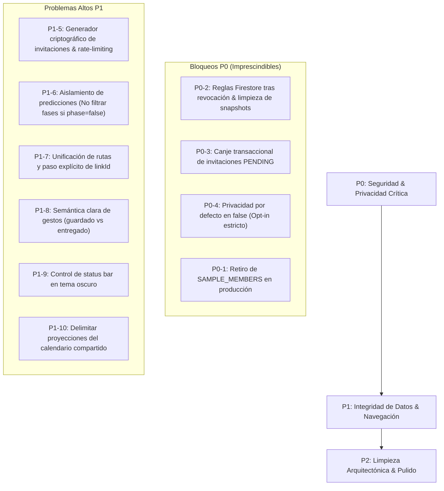

# Plan de Correcciones Recomendadas — Lumi Bonds
**Fecha:** 12 de octubre de 2026  
**Auditor:** Principal Android Software Auditor & Security Architect  
**Estado:** PENDIENTE DE AUTORIZACIÓN PARA IMPLEMENTAR EN PRODUCCIÓN

---

## 1. Orden de Implementación Recomendado



---

## 2. Propuestas Técnicas Concretas por Hallazgo

### Bloque 1 — Bloqueos Críticos (P0)

#### Corrección P0-2: Revocación segura en `firestore.rules` y `PartnerRepositoryImpl`
1. En `firestore.rules`:
   ```javascript
   // Permitir get/list solo si el vínculo está ACTIVE o si eres el owner en PENDING
   allow get: if request.auth != null && (
     (resource.data.status == 'ACTIVE' && (
       resource.data.ownerUid == request.auth.uid ||
       resource.data.partnerUid == request.auth.uid
     )) ||
     (resource.data.status == 'PENDING' && resource.data.ownerUid == request.auth.uid)
   );
   ```
2. En `PartnerRepositoryImpl.kt` (`unlink`):
   Al revocar, no solo actualizar `status = REVOKED`, sino limpiar los campos de salud del documento:
   ```kotlin
   firestore.collection(LINKS).document(linkId).update(mapOf(
       "status" to LinkStatus.REVOKED.name,
       "ownerSnapshot" to null,
       "partnerSnapshot" to null,
       "ownerFcmToken" to null,
       "partnerFcmToken" to null
   )).await()
   ```

#### Corrección P0-3: Canje de invitaciones compatible con reglas
Reemplazar el `transaction.get(linkRef)` directo por una Cloud Function autenticada `claimPartnerInvitation({ code })` o ajustar la regla de `partner_links` para permitir el reclamo atómico si se presenta el código válido en la misma operación.

#### Corrección P0-4: Privacidad por defecto en `false`
En `PartnerModels.kt`, `BondsPrivacySettings.kt` y `BondsViewModel.kt`:
```kotlin
data class SharePreferences(
    val phase: Boolean = false,
    val mood: Boolean = false,
    val symptoms: Boolean = false,
    val predictions: Boolean = false
)
```

#### Corrección P0-1: Eliminar datos ficticios en flujos de producción
En `BondsViewModel.kt:258`:
```kotlin
// En producción, si memberList está vacía, mostrar estado vacío real
val resolvedMembers = memberList
```
Mover `SAMPLE_MEMBERS` a un archivo de fixtures bajo `@Preview(showBackground = true)` para diseño y demos explícitos.

---

### Bloque 2 — Problemas Altos (P1)

#### Corrección P1-5: Generación robusta de códigos de invitación
En `PartnerRepositoryImpl.kt`:
```kotlin
private val secureRandom = java.security.SecureRandom()
private fun generateSecureLinkCode(): String {
    val number = 100000 + secureRandom.nextInt(900000)
    return number.toString()
}
```
Validar en transacción que el código no exista previamente en `partner_invitations`.

#### Corrección P1-6: Aislamiento estricto de inferencia de fases
En `SnapshotPrivacy.kt`:
Si `privacy.phase == false`, **no exponer** `cycleStartDateMs`:
```kotlin
fun CycleSnapshot.filteredBy(privacy: SharePreferences): CycleSnapshot = copy(
    currentPhase = if (privacy.phase) currentPhase else CyclePhase.UNKNOWN,
    currentMood = if (privacy.mood) currentMood else null,
    topSymptoms = if (privacy.symptoms) topSymptoms else emptyList(),
    daysUntilNextPhase = if (privacy.predictions && privacy.phase) daysUntilNextPhase else 0,
    cycleStartDateMs = if (privacy.predictions && privacy.phase) cycleStartDateMs else null,
    cycleLengthDays = if (privacy.predictions && privacy.phase) cycleLengthDays else 0,
    periodLengthDays = if (privacy.predictions && privacy.phase) periodLengthDays else 0
)
```

#### Corrección P1-7: Unificación de rutas y paso explícito de identificadores
En `MainScreen.kt`:
Asegurar que `BottomNavItem.Bonds` pase las lambdas correctas al grafo raíz:
```kotlin
onOpenMemberDetail = { member -> rootNavController.navigate("bonds_member_detail/${member.linkId}") },
onOpenSendGesture = { member, action -> rootNavController.navigate("bonds_send_gesture/${action.name}?linkId=${member?.linkId ?: ""}") }
```

#### Corrección P1-9: Control de StatusBar en tema oscuro
En `BondsHomeScreen.kt` y pantallas de Bonds:
```kotlin
val view = LocalView.current
SideEffect {
    val window = (view.context as Activity).window
    WindowCompat.getInsetsController(window, view).isAppearanceLightStatusBars = true
}
```

---

## 3. Pruebas de Verificación Obligatorias Tras Corrección

1. **Re-ejecución de suite en Firestore Emulator:**
   - Confirmar que `getDoc` de un usuario revocado devuelve `PERMISSION_DENIED`.
   - Confirmar que el canje con código de invitación es aceptado sin excepciones.
2. **Re-ejecución de suite de inferencia de privacidad (`BondsPrivacyInferenceTest`):**
   - Confirmar que cuando `phase = false` y `predictions = true`, `cycleStartDateMs` es `null` y la fase menstrual no puede ser calculada.
3. **Prueba en Emulador Android:**
   - Verificar que al no haber vínculos activos se renderiza la tarjeta vacía `"Añadir persona de confianza"`.
   - Verificar legibilidad de iconos de barra de estado en modo oscuro.
